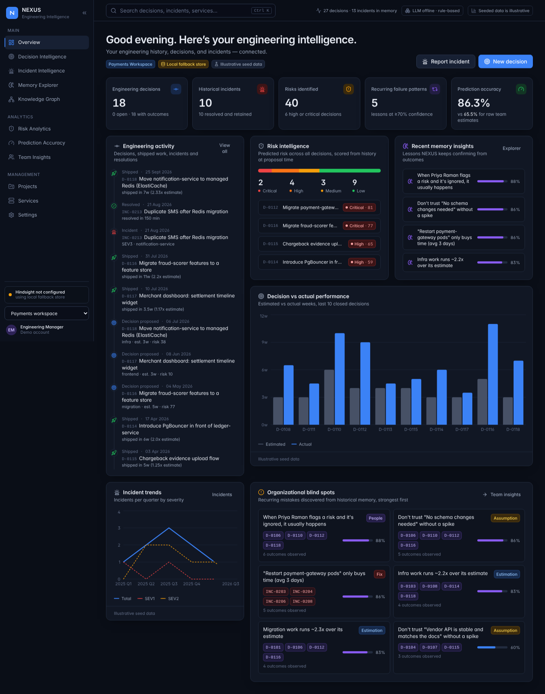
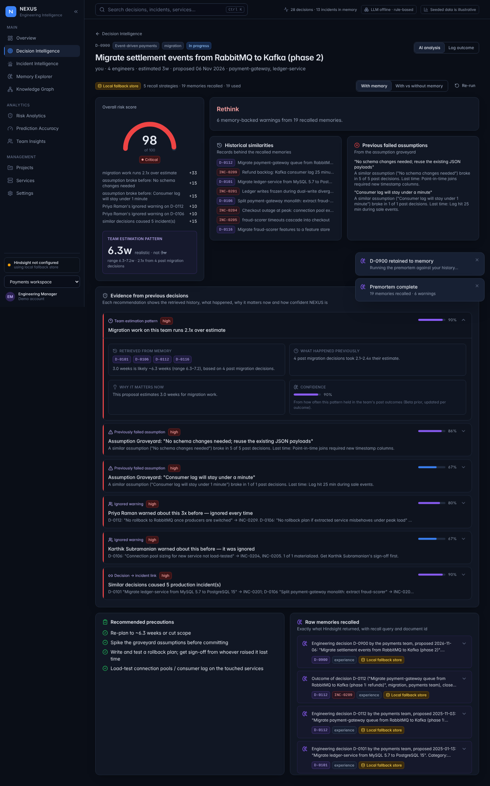
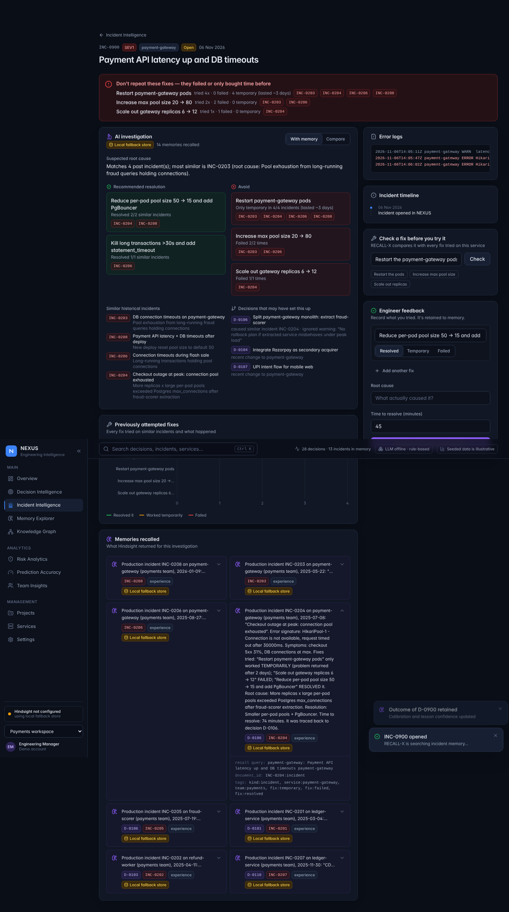
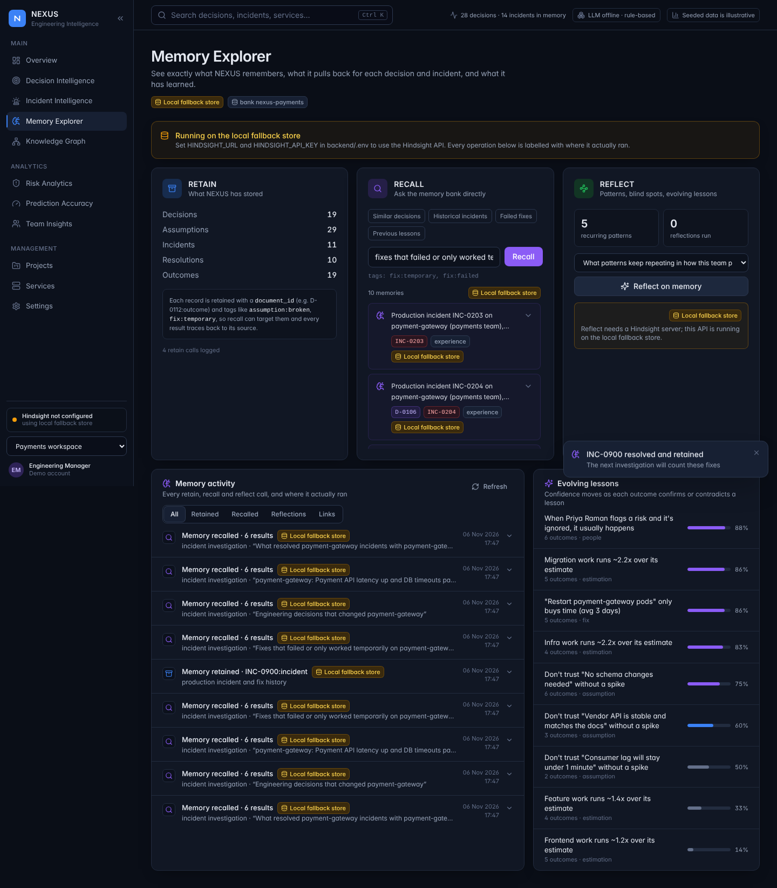
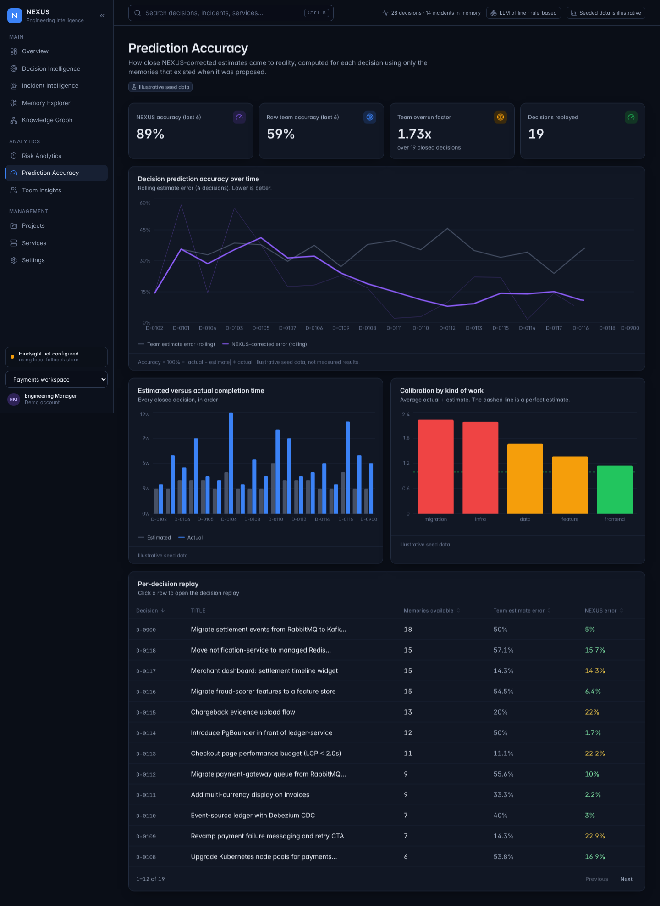

# NEXUS — engineering memory that learns from every decision and incident

NEXUS is an AI agent that remembers what an engineering team decided, what it assumed, who warned about what, how long the work actually took, and which production incidents followed. It uses that memory twice:

- **PREMORTEM — learn before failure.** Before a team commits to a proposal, NEXUS checks it against the team's own history: "your last 4 migrations ran 2.3x over", "'no schema changes needed' broke 5 of 5 times", "Priya warned about rollback 3 times, was ignored, and each time it turned into an incident".
- **RECALL-X — learn after failure.** When production breaks, NEXUS recalls similar incidents, which fixes resolved them, which ones only bought a few days ("restarting payment-gateway lasted ~3 days, 4 of 4 times"), and which earlier decision probably set the failure up.

[Hindsight](https://github.com/vectorize-io/hindsight) is the memory layer for both engines. Every decision, outcome, incident and fix is retained into a per-team Hindsight memory bank; every recommendation is built from Hindsight recall and reflect, and links back to the memories it came from.

> The data in this repository is synthetic: two fictional teams (payments, platform) with 27 decisions and 13 incidents, written to contain realistic patterns. No claim here describes a real company.





---

## Features

| # | Feature | Where | Hindsight call |
|---|---|---|---|
| 1 | Decision capture from a pasted ADR / design doc / epic | Premortem → *Save as decision* · `POST /decisions/capture` | `retain` |
| 2 | Premortem report with memory-backed warnings | Premortem · `POST /premortem` | 5 parallel `recall` strategies |
| 3 | Outcome logging that closes the loop | Decisions → open decision · `POST /decisions/{id}/outcome` | `retain` |
| 4 | Evidence panel (every warning cites D-/INC- IDs) | Premortem, Incidents, record drawer | `recall` results → `document_id` |
| 5 | With vs without memory, side by side | Premortem, Incidents | same LLM, memory off |
| 6 | Estimation calibration and corrected estimate | Premortem, Lessons | recall + as-of stats |
| 7 | Assumption graveyard | Premortem warnings, Lessons | `recall(tags=["assumption:broken"])` |
| 8 | Ignored warnings tracker (credits the people who were right) | Premortem warnings, Lessons | `recall(tags=["risk:ignored"])` |
| 9 | Learning curve (raw vs NEXUS-corrected estimate error over time) | Lessons | computed as-of each decision |
| 10 | Lesson evolution with confidence history | Lessons | `reflect` + Beta-updated confidence |
| 11 | Decision DNA graph | Decision DNA | — |
| 12 | Pre-commit nudge for PRs and Slack | PR & Slack nudge · `.github/workflows/nexus-premortem.yml` | premortem pipeline |
| 13 | Team vs team (separate memory banks) | Team vs team | one bank per team |
| 14 | Decision replay ("what would NEXUS have said then?") | Decisions → closed decision · `GET /replay/{id}` | recall filtered to memories that existed then |
| + | RECALL-X: failed-fix memory, fix decay, decision → incident link, feedback loop | Incident investigator · `POST /incidents/investigate`, `/resolve` | `recall(tags=["fix:temporary","fix:failed"])`, `retain` |

### Advanced engineering intelligence

| Capability | Page | What it does |
|---|---|---|
| Decision DNA | `/dna` | Recurring decision patterns and blind spots, each counted from records with evidence, trend and confidence |
| What-If Simulator | `/whatif` | Compares two options against the team's history (labelled hypothetical) |
| Risk Propagation | `/propagation` | Service dependency graph: declared, observed and inferred edges, plus blast radius of a decision |
| Memory Conflicts | `/conflicts` | Detects memories that disagree and explains the context difference |
| Learning Engine | `/learning` | The retain → recall → predict → outcome → reflect loop, and how each outcome moved each lesson |
| Knowledge Retention | `/knowledge` | Undocumented decisions, missing root causes, missing runbooks, knowledge concentration |
| Memory Scorecard | `/scorecard` | 8 organisational memory metrics with formula, trend, records and data completeness |

What is verified, partial and pending: [docs/IMPLEMENTATION_REPORT.md](docs/IMPLEMENTATION_REPORT.md).

## Architecture

```
          Engineering inputs                        NEXUS (FastAPI)                         Hindsight
 ┌───────────────────────────────┐     ┌──────────────────────────────────────┐    ┌───────────────────────┐
 │ ADRs · design docs · epics    │────▶│ Capture (LLM extract → structured)   │───▶│ retain                │
 │ outcomes · retros             │     │                                      │    │  bank: nexus-payments │
 │ alerts · logs · incidents     │────▶│ PREMORTEM ─┐                         │◀──▶│  bank: nexus-platform │
 │ fixes tried + results         │     │ RECALL-X ──┼─ parallel recall (tags) │    │ recall (4 strategies) │
 └───────────────────────────────┘     │            ├─ as-of analytics        │    │ reflect (lessons)     │
                                       │            └─ Groq synthesis         │    └───────────────────────┘
 ┌───────────────────────────────┐     │                                      │    ┌───────────────────────┐
 │ React dashboard · PR comment  │◀────│ evidence → D-/INC- records (SQLite)  │    │ Groq gpt-oss-120b     │
 │ Slack /premortem              │     └──────────────────────────────────────┘    │ fallback qwen3-32b    │
 └───────────────────────────────┘                                                 └───────────────────────┘
```

More detail, including the memory schema and the request flow, is in [docs/ARCHITECTURE.md](docs/ARCHITECTURE.md). The business model is in [docs/BUSINESS_MODEL.md](docs/BUSINESS_MODEL.md).

| Incident investigation | Memory Explorer | Prediction accuracy |
|---|---|---|
|  |  |  |

## How Hindsight memory is used

**One bank per team.** `nexus-payments` and `nexus-platform` are created with a mission ("remember decisions, assumptions, estimates vs actuals, ignored risks, incidents, which fixes failed…") and a skeptical disposition, so reflection behaves like a staff engineer running a premortem (`app/memory.py`).

**What gets retained.** Each record is written as narrative text so Hindsight's extraction pulls out entities (people, services), time and relationships:

| Memory | `document_id` | Tags |
|---|---|---|
| Decision proposal | `D-0112:proposal` | `kind:decision`, `category:migration`, `service:payment-gateway` |
| Decision outcome | `D-0112:outcome` | `kind:outcome`, `assumption:broken`, `risk:ignored` |
| Incident + fixes | `INC-0204:incident` | `kind:incident`, `fix:temporary`, `fix:failed`, `fix:resolved` |

Timestamps are the real proposal / close / incident dates, so temporal recall works.

**How it is recalled.** A premortem runs five recall strategies in parallel (similar proposals, estimate history, broken assumptions, ignored risks, incidents on the same services). Results are de-duplicated and each one is resolved back to its source record through `document_id`, which is what the evidence panel shows.

**How it learns.** When an outcome is logged or an incident resolved, it is retained immediately. The next premortem or investigation recalls it, the calibration factor and lesson confidences move, and the UI shows the before/after ("Migration factor 2.30x → 2.34x; 'Don't trust no schema changes' 86% → 88%").

**What the LLM is and isn't trusted with.** Numbers (factors, break rates, fix decay, confidence) are computed deterministically from the history, as of the date being analysed. Groq phrases the summary, verdict and checklist, and may add at most two extra warnings, which must cite a recalled memory.

## Run it

### 1. Hindsight
Either **Hindsight Cloud** (sign up at https://ui.hindsight.vectorize.io, add promo `MEMHACK99` under Billing, create an API key) or local Docker:

```bash
# set the LLM provider env vars listed in https://hindsight.vectorize.io/developer/installation#docker
docker run --rm -it -p 8888:8888 -p 9999:9999 ghcr.io/vectorize-io/hindsight:latest
# API: http://localhost:8888   UI: http://localhost:9999
```
Hindsight Cloud is the quicker option: no container, models included.

### 2. Backend
```bash
cd backend
python -m venv .venv && source .venv/bin/activate      # Windows: .venv\Scripts\activate
pip install -r requirements.txt
cp .env.example .env        # fill HINDSIGHT_URL, HINDSIGHT_API_KEY (Cloud), GROQ_API_KEY
python -m app.seed --reset  # creates both banks and retains 67 memories
uvicorn app.main:app --reload --port 8000
```
Open http://localhost:8000/docs for the API. `GET /health` must say `"memory_mode": "hindsight"` and `"llm_mode": "groq"`.

### 3. Frontend
```bash
cd frontend
npm install
npm run dev                 # http://localhost:5173  (set VITE_API_URL if the API isn't on :8000)
npm run build               # type-checks (strict TS) and builds to dist/
```
React 18 + TypeScript + Tailwind + Lucide + Recharts + Framer Motion + d3-force. Pages: Overview, Decision Intelligence (multi-step New Decision → AI analysis, outcome feedback, decision replay), Incident Intelligence (create → RECALL-X investigation, failed-fix warnings, fix check, engineer feedback), Memory Explorer (retain / recall / reflect consoles and a live memory-operation audit feed), Knowledge Graph (zoom, pan, drag, details panel), Risk Analytics, Prediction Accuracy, Team Insights, Projects, Services, Settings.

Every memory item in the UI carries a source badge: **Hindsight API** (a real call), **Local fallback store** (no Hindsight configured) or **Illustrative seed data**. The backend logs every retain / recall / reflect call with where it ran (`GET /memory/activity`), and the Memory Explorer shows that log.

```
frontend/src/
  components/ui/       design system: Card, Button, Badge, Dialog, DataTable (sort + paging), Toasts, states
  components/memory/   EvidenceCard, MemoryItem, RecordDrawer
  layout/              collapsible sidebar, top bar with global search (Ctrl K)
  pages/               one file per route
  charts/              chart theme, tooltip, legend
  services/api.ts      typed API client
  state/app.tsx        workspace, health, toasts, refresh
  types/               API types
```

The structured record store is SQLite (zero setup for judges). It sits behind `app/store.py`, so moving it to PostgreSQL only touches that module.

Without `HINDSIGHT_URL` the backend boots with a small in-process keyword store so the UI can be developed offline; the sidebar shows "Memory: local fallback" in amber. Without `GROQ_API_KEY` the agents fall back to deterministic, memory-derived output. Use both keys for the demo.

### Docker
`docker compose up --build` starts the API on :8000 (reads `backend/.env`).

## Edge cases handled
- Groq JSON / function-calling failures: JSON mode → plain mode → fallback model → JSON repair → deterministic output (`app/llm.py`).
- A proposal with no similar history: "first decision of its kind" notice instead of invented warnings.
- Recall with tags failing on a server: retried without tags.
- Decision replay never leaks the future: memories whose source record was proposed or closed after the replay date are dropped.
- Empty or unreachable API: clear error messages in the UI; seeding never blocks startup.
- Repeatable demos: *Reset demo memory* in the sidebar (or `python -m app.seed --reset`) deletes and recreates both banks.

## Repository layout
```
backend/
  app/main.py            API routes (all 14 features)
  app/memory.py          Hindsight banks, retain / recall / reflect, evidence resolution
  app/agents/capture.py  decision extraction
  app/agents/premortem.py PREMORTEM engine
  app/agents/recallx.py  RECALL-X engine
  app/analytics.py       as-of calibration, graveyard, ignored warnings, lessons, fix decay, graph
  app/llm.py             Groq with retries and fallbacks
  app/seed.py            loads the synthetic history into Hindsight
  data/generate_dataset.py  synthetic history (edit and re-run to change the story)
frontend/src/            React + Recharts + d3-force dashboard
docs/                    architecture, business model, demo script, submission checklist
.github/workflows/       PR premortem nudge
```

## License
MIT
