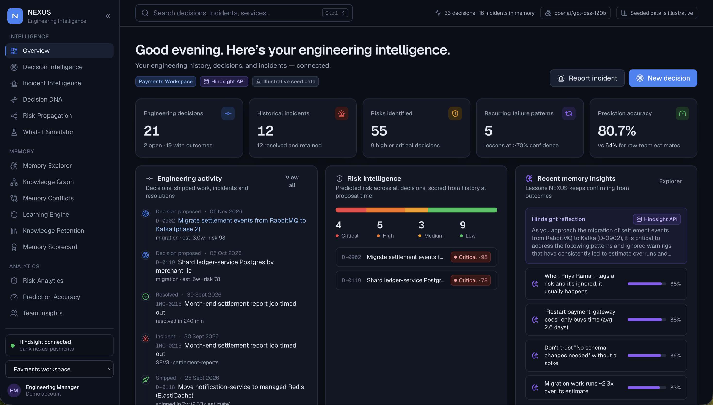
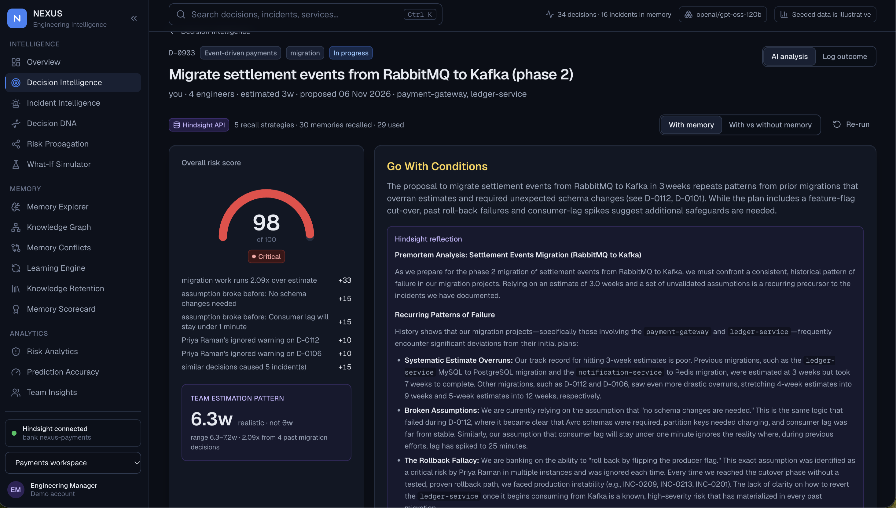
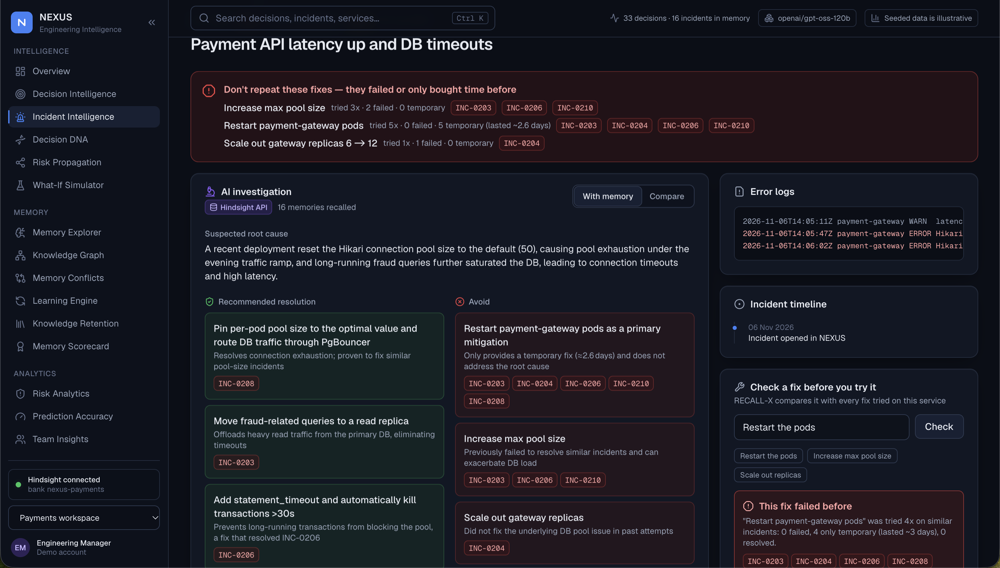
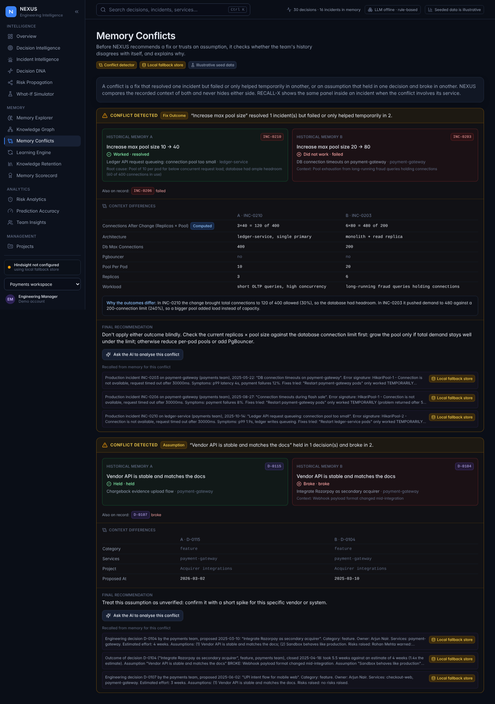
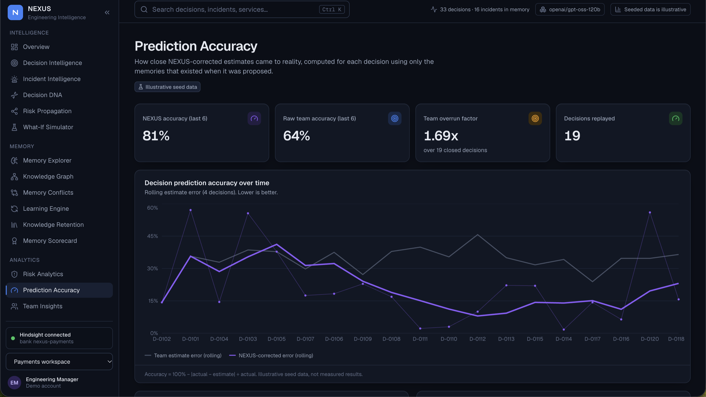

# Hindsight remembers which incident fixes only bought three days

At 2 AM, someone on our payments team restarted `payment-gateway`. The connection timeouts stopped, everyone went back to sleep, and three days later the same alert fired. Someone restarted it again.

Nobody was being careless. The person on call simply didn't know the restart had been tried before and had only ever bought a few days. That knowledge existed. It was buried in a postmortem, a Slack thread and one engineer's memory. What didn't exist was anything that would put it in front of the next person at the moment they needed it.

So I built NEXUS: an agent that remembers what an engineering team decided, what it assumed, who warned about what, how long the work really took, and which fixes actually worked. The memory layer is [Hindsight](https://github.com/vectorize-io/hindsight), and it ended up shaping the whole design.



## What NEXUS does

NEXUS has two engines that share one memory.

**PREMORTEM** runs *before* a decision. You describe a plan ("Move settlement events to Kafka, 3 weeks, no schema changes needed") and it checks it against the team's history: how far similar work overran, which of your assumptions have broken before, and whose warnings were ignored last time.

**RECALL-X** runs *after* something breaks. You paste the alert and logs, and it tells you which fixes resolved similar incidents, which ones failed, which ones only worked temporarily and for how long, and which earlier decision probably set the failure up.

Both read and write the same per-team Hindsight memory bank. Every outcome someone logs (actual effort, broken assumptions, what fixed the outage) is retained immediately, so the next premortem or investigation starts smarter.

To test it I seeded two fictional teams with about 30 decisions and 16 incidents, written to contain realistic patterns. Every number in this article comes from that illustrative history, not from a real company.

## The core idea: remember failures, not just facts

My first instinct was to treat this like retrieval: dump the postmortems into a store and search them. That gives you documents. What I actually needed was the *relationship* between a decision, its assumptions and what happened afterwards, and the ability to ask targeted questions about it: "which assumptions broke?", "which warnings were ignored?", "which fixes were temporary?"

Hindsight made that practical in two ways: the `retain` call takes tags and a `document_id`, and `recall` can filter on tags. So every memory NEXUS writes is narrative text (so Hindsight can extract entities, people, services and time) plus structured tags for targeting:

```python
def decision_tags(d: dict, phase: str) -> list[str]:
    tags = [f"kind:{phase}", f"category:{d['category']}", f"team:{d['team']}"]
    tags += [f"service:{s}" for s in d.get("services", [])]
    if phase == "outcome":
        if any(not a.get("held") for a in d.get("assumptions", [])):
            tags.append("assumption:broken")
        if any(not r.get("addressed") for r in d.get("risks", [])):
            tags.append("risk:ignored")
    return tags
```

Incidents get `fix:temporary`, `fix:failed` and `fix:resolved` the same way. The `document_id` is always something like `D-0112:outcome` or `INC-0204:incident`, which turned out to be the most useful decision I made: every recalled memory can be traced back to the exact record it came from, so every warning in the UI cites its evidence.

Each team gets its own bank (`nexus-payments`, `nexus-platform`), created with a mission and a reflect mission that tells Hindsight to behave like a skeptical staff engineer running a premortem. Keeping banks separate matters more than I expected: in the seeded data, the payments team underestimates migrations by about 2.3x while the platform team is fine at migrations and terrible at compliance work. One shared memory would have blurred both.

## How a premortem uses memory

A single premortem runs five recall strategies in parallel, each aimed at a different kind of failure:

```python
strategies = [
    (f"{title}. {parsed.get('summary', '')}", None),
    (f"How far over estimate did past {cat} work run? actual vs estimated weeks", ["kind:outcome"]),
    (f"Assumptions that broke: {'; '.join(assumptions) or title}", ["assumption:broken"]),
    (f"Risks people raised that were ignored for {', '.join(services) or cat} work, e.g. rollback", ["risk:ignored"]),
    (f"Production incidents on {', '.join(services) or title} caused by earlier decisions", ["kind:incident"]),
]
raw = memory.recall_many(team, strategies, limit=6)
```

Then `reflect` asks the bank what the team should remember before committing, and the LLM (Groq, `gpt-oss-120b`) writes the summary and checklist.

One rule I'm glad I set early: **the LLM never does the arithmetic.** Calibration factors, break rates and how long a fix lasted are computed deterministically from the records, and passed to the model as facts it isn't allowed to change. The model explains; the history counts. It removed a whole class of confident-but-invented numbers.

## Before and after

Here's the same proposal with the same model, once without memory and once with it:

> *Migrate settlement events from RabbitMQ to Kafka. Estimate 3 weeks. Assumptions: no schema changes needed; consumer lag will stay under a minute; we can roll back by flipping the producer flag.*

**Without memory**, the agent gives the list every premortem has: data loss during cutover, performance regression, add buffer, update runbooks. All correct, and none of it changes the plan.

**With Hindsight**, it says:

- Migration work on this team has run about 2.1x over, so 3 weeks is realistically about 6.3 (based on 4 past migrations).
- "No schema changes needed" was assumed in 5 past decisions and broke in all 5.
- Priya warned about rollback on three earlier decisions. She was ignored each time, and each time it became an incident.
- Similar decisions on these services led to 5 production incidents.

Every bullet links to the decisions and incidents behind it.



On the incident side, the restart story finally gets its answer. For a new `HikariPool - Connection is not available` alert on `payment-gateway`, RECALL-X shows that restarting was tried on four similar incidents and only ever lasted about three days, that increasing the pool size failed twice, and that reducing per-pod pools and adding PgBouncer resolved it twice. You can even type a fix you're about to try and it will warn you if it failed before.



## The part I didn't plan for: memories that disagree

Once the history grew, Hindsight started returning memories that contradicted each other. In one incident, increasing the database connection pool fixed the problem. In two others, the same fix made things worse.

A naive agent would average those or pick the most recent. Instead, NEXUS now detects the conflict and compares the context recorded with each incident. In this case the difference is arithmetic: in the incident where a bigger pool worked, 3 replicas × 40 connections used 120 of 400 available. Where it failed, 6 replicas × 80 asked for 480 against a limit of 200. The recommendation becomes "check replicas × pool size against the database limit first", not "increase the pool" or "never increase the pool".



That's the behaviour I'd want from a senior engineer: don't hide the contradicting evidence, explain it.

## Does it actually get better?

To check that memory improves predictions rather than just decorating them, I replayed every closed decision in order, letting NEXUS use only the memories that existed on the day each one was proposed. On the seeded history, raw team estimates were off by roughly 36% on average over the last few decisions, while memory-corrected estimates were off by about 19%. That's illustrative data, so treat it as a proof of mechanism rather than a benchmark, but the direction is the point: the agent improves because outcomes are retained and recalled, not because any model was retrained.



## Lessons learned

**1. Store failures and their context, not just outcomes.** "Restart worked" is almost useless. "Restart worked and the problem came back in 3 days, with 6 replicas and a 200-connection limit" is what makes the next decision better.

**2. Give every memory a document ID you can trace.** Without it, the UI can only say "memory says so". With it, every warning is auditable, and that's what makes engineers trust it.

**3. Tags turn recall from search into questions.** Five targeted recalls ("broken assumptions", "ignored risks", "temporary fixes") beat one broad query every time.

**4. Keep the LLM away from the math.** Let memory and code produce the numbers, and let the model explain them.

**5. One thing that hurt:** the synchronous Hindsight client didn't play well inside FastAPI's thread pool, because each worker thread ended up with its own event loop. Running every Hindsight call on one dedicated async loop fixed it and made the parallel recalls genuinely parallel.

If you want to try this pattern yourself, start with the [Hindsight documentation](https://hindsight.vectorize.io/) and the [Hindsight GitHub repository](https://github.com/vectorize-io/hindsight). Vectorize also has a good primer on [what agent memory is and why it differs from RAG](https://vectorize.io/what-is-agent-memory). My biggest takeaway: the most valuable thing an engineering agent can remember isn't what worked. It's what only *looked* like it worked.

*NEXUS is open source: [github.com/Divyashree4757/NEXUS](https://github.com/Divyashree4757/NEXUS). Built with help from Code.in.*
