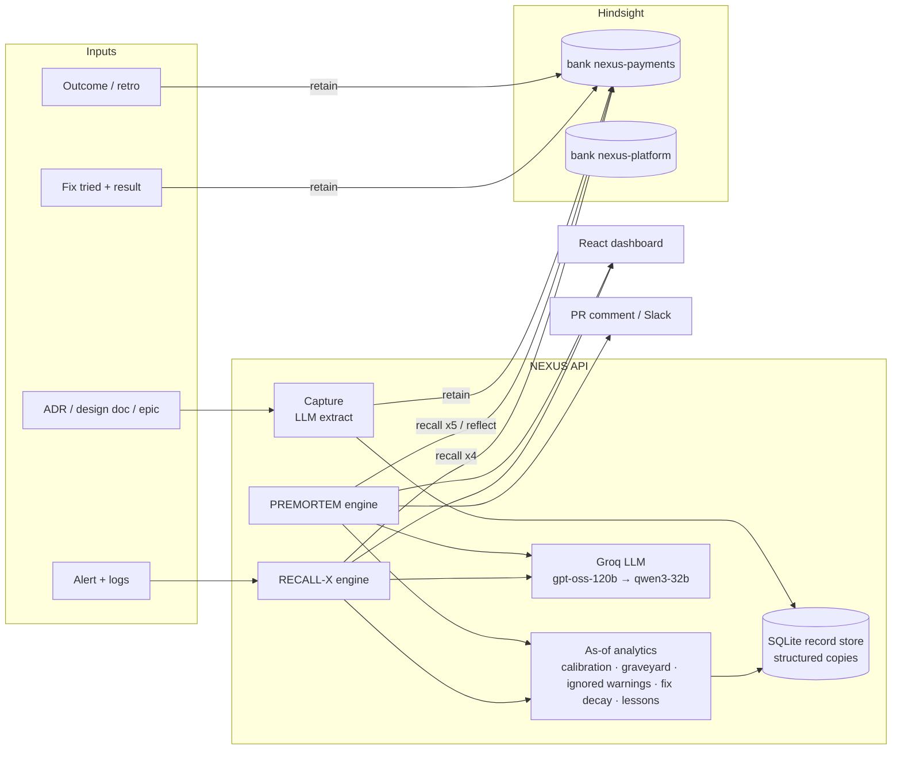

# NEXUS architecture

NEXUS is one product with two engines that share one memory.

| | PREMORTEM | RECALL-X |
|---|---|---|
| When | Before a decision is committed | After something breaks |
| Learns from | Decisions, assumptions, estimates vs actuals, ignored risks | Incidents, fixes tried, how long they lasted, root causes |
| Answers | "What has this team got wrong on work like this before?" | "Have we seen this, what did we try, what actually fixed it, and which decision set it up?" |

The link between them is the **decision → incident connection**: outcomes record which incidents a decision caused, incidents record the decision they were traced back to. A premortem warns "similar decisions caused 5 incidents"; an investigation says "D-0106 probably set this up, and Priya's ignored warning on it was about exactly this".

## Components

## Why there are two stores

Hindsight is the memory the agents reason over: it extracts facts, entities (people, services) and time from narrative text and retrieves them with semantic, keyword, graph and temporal strategies. Every number NEXUS shows, though, has to be exact and reproducible: a factor of 2.3x, 5 of 5 broken assumptions, fixes that lasted 3 days. Those come from a structured copy of the same records in SQLite. Recalled memories carry their `document_id` (`D-0112:outcome`), which joins the two: the evidence panel shows the recalled memory text and the record it came from.

## Request flow: premortem

1. **Capture.** Groq extracts title, category, estimate, services, assumptions and risks (`agents/capture.py`). Heuristic fallback if the LLM fails.
2. **Recall.** Five strategies run in parallel against the team's bank (`memory.recall_many`):
   - the proposal itself (similar past decisions)
   - estimate history for the category (`tags=["kind:outcome"]`)
   - broken assumptions (`tags=["assumption:broken"]`)
   - ignored risks on the touched services (`tags=["risk:ignored"]`)
   - incidents on those services (`tags=["kind:incident"]`)
3. **Analyse.** Deterministic, as-of-dated stats (`analytics.py`):
   - corrected estimate: category factor shrunk toward the team factor, `(Σ cat ratios + 2·team) / (n + 2)`
   - assumption graveyard match on the claim before any justification ("No schema changes needed; …")
   - ignored warnings grouped by person, ranked by service/category overlap
   - past decisions on the same services that caused incidents
4. **Reflect.** `reflect` on the team bank for the lessons to remember before committing.
5. **Synthesise.** Groq writes the summary, verdict and checklist. Numbers are passed in and must not change; extra warnings must cite a recalled memory.
6. **Return** the report, the evidence (memories + source records) and memory stats.

## Request flow: incident

1. Parse service and error signature.
2. Four recall strategies: same signature, failed/temporary fixes, what resolved it, recent decisions on the service.
3. Fix decay: cluster every fix tried on similar incidents; count resolved / temporary / failed; average days a temporary fix lasted.
4. Suspect decisions: decisions linked to similar incidents, plus recent changes to the service, with their ignored risks.
5. Groq: hypothesis, do-this list, don't-repeat list. Deterministic version if the LLM fails.
6. The engineer logs what fixed it → `retain`. The next investigation counts it.

## Decision replay and the learning curve

Every analytic takes an `as_of` date and only looks at records closed before it. Replay re-runs the premortem as of the decision's proposal date, drops recalled memories whose source record didn't exist yet, and compares the warnings with what actually happened. The learning curve does the same for every closed decision in order, so the drop in estimate error is what the agent would really have achieved with the memory it had at the time.

## Lesson confidence

Each lesson is a hypothesis with a Beta(1,1) prior. Every relevant outcome either confirms it (a migration ran ≥1.5x over; the assumption broke; the ignored risk materialised; the restart only lasted days) or contradicts it. Confidence = (confirmations + 1) / (observations + 2), and the history of that value is what the lesson chart shows.

## Failure handling

| Failure | Behaviour |
|---|---|
| Groq returns invalid JSON or a tool-call error | JSON mode → plain → fallback model → repair → deterministic output |
| Recall with tags rejected | retried without tags, lower budget |
| No similar history | "first decision of its kind" instead of invented warnings |
| Hindsight not configured | in-process keyword store, clearly flagged in `/health` and the UI |
| Seeding fails at startup | logged; API still starts |
